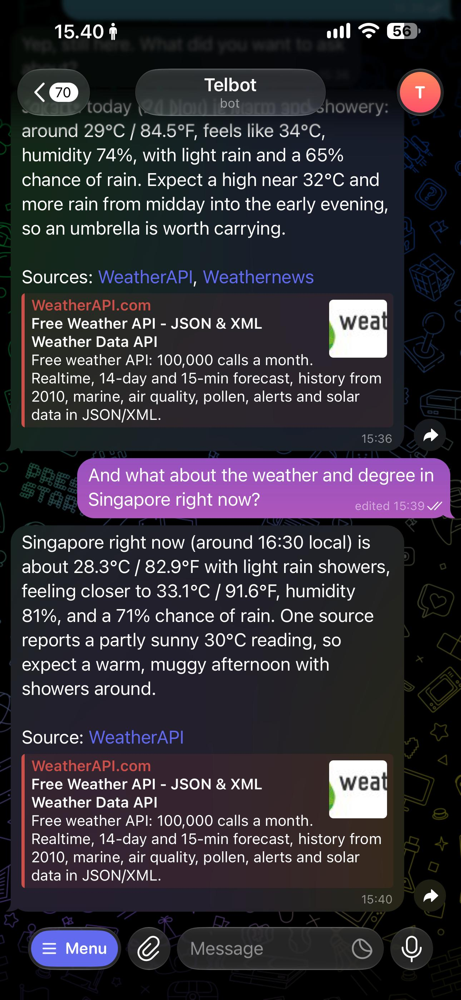
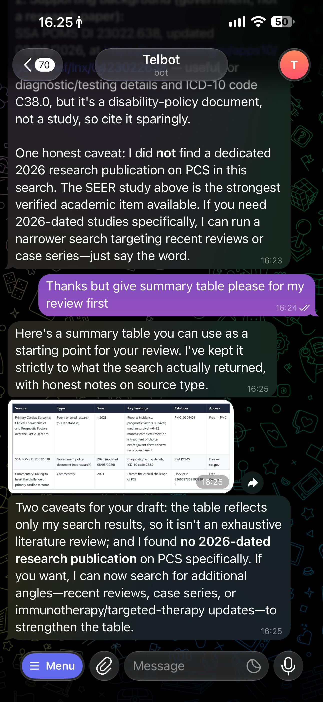
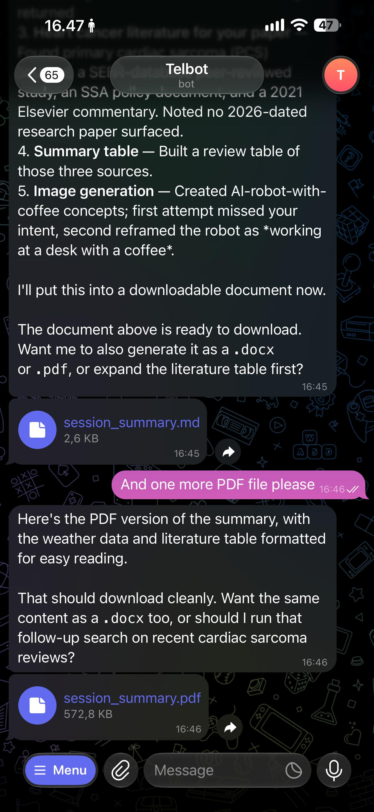
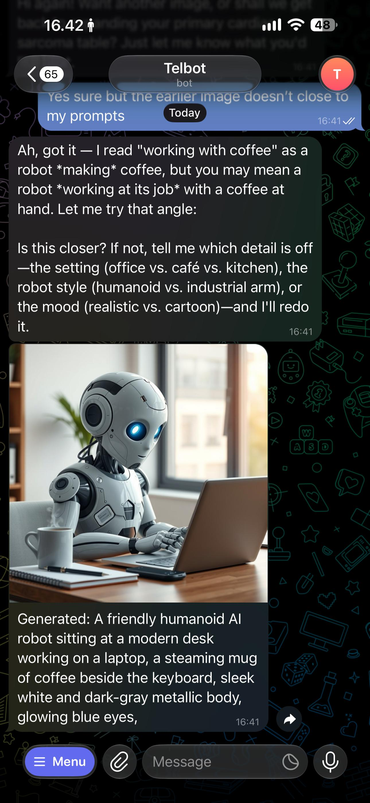
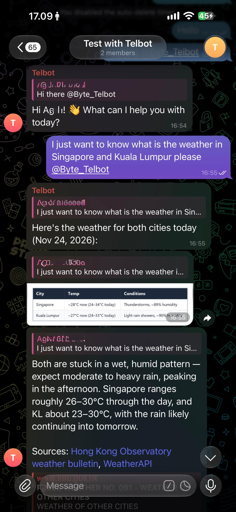
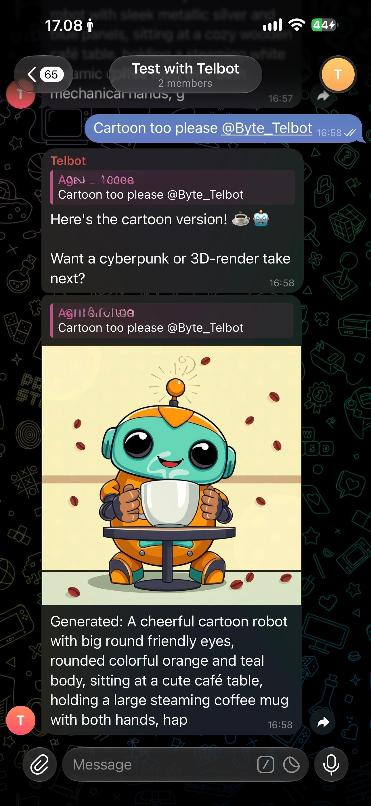

# Telbot — Open-Access Community Telegram AI Bot

[](https://github.com/anugrahwork/telbot/actions/workflows/ci.yml)
[](https://www.python.org/)
[](LICENSE)
[](Dockerfile)
[](.env.example)

**Telbot** is a clean, security-hardened Telegram AI assistant designed specifically for public communities and self-hosters. Clone the repo, drop in your `@BotFather` `BOT_TOKEN` and any OpenAI-compatible API key, and launch locally in seconds or deploy straight to **Docker**, **Render**, or **Railway**.

> **Zero lock-in, zero hardcoded secrets, public-safety defaults built in.**

---

## Live Demo Screenshots

<table>
  <tr>
    <td align="center">
      <br />
      <strong>Live Web Search &amp; Citations</strong>
    </td>
    <td align="center">
      <br />
      <strong>Smart Hybrid Tables (PNG)</strong>
    </td>
    <td align="center">
      <br />
      <strong>Downloadable <code>.md</code> &amp; <code>.pdf</code> Export</strong>
    </td>
  </tr>
  <tr>
    <td align="center">
      <br />
      <strong>Conversational Image Generation</strong>
    </td>
    <td align="center">
      <br />
      <strong>Group <code>@mention</code> + Live Table</strong>
    </td>
    <td align="center">
      <br />
      <strong>Group Context Memory &amp; Styles</strong>
    </td>
  </tr>
</table>

---

## Why Telbot?

- **Built for Untrusted Public Communities:**
  - **Per-User Rate Limits & Concurrency Guards:** `3` burst / `10s`, `6/min` per user, `20/min` shared group limit, and 1 active request per user lock.
  - **UTC Daily Quotas:** Persisted caps (`50` messages, `15` searches, `5` images, `10` files/day by default) keep API spend predictable.
  - **Fail-Closed Admin Access:** Empty `ADMIN_USERS` grants **zero** admin privileges until you explicitly add your Telegram User ID.
  - **Polite Group Etiquette:** Defaults to `GROUP_TRIGGER_MODE=mention_or_reply` (responds only on `@mention`, reply-to-bot, `/ask`, or `/search`) with Forum Topic thread isolation.
- **Hardened Against Abuse & Prompt Injection:**
  - DNS + IPv4/IPv6 + IPv4-mapped IPv6 SSRF guard with redirect validation.
  - Per-request random-nonced `<untrusted_data_xxxxxxxx>` prompt wrappers.
  - Resource-bounded AST math evaluator, zip-bomb/XXE-safe `.docx` parser, and sanitized downloadable filenames.
- **Rich Telegram Experience:**
  - **Smart Hybrid Tables:** Compact Markdown tables render inline as aligned Unicode `<pre>` blocks; wide tables render automatically as crisp styled PNG images.
  - **Paywall-Skipping Live Search:** Works out of the box with DuckDuckGo + Crossref Open-Access (and upgrades automatically with `TAVILY_API_KEY`), filtering paywalls and verifying cited links before replying.
  - **Vision, Docs & Export:** OpenAI-compatible Vision (`VISION_MODEL`) + optional Cloudflare / OCR.space, PDF/DOCX/code reading, and styled `.pdf` / `.docx` / code file generation with charts.
- **Zero-Config Persistence:** Built-in WAL-mode SQLite (`data/bot.db`) with automatic idle data retention (`30` days), plus optional Supabase cloud sync.

---

## Works With Any OpenAI-Compatible Provider

| Provider | `AI_BASE_URL` | Example `AI_MODEL` |
| :--- | :--- | :--- |
| **OpenAI** | `https://api.openai.com/v1` | `gpt-4o-mini` |
| **OpenRouter** | `https://openrouter.ai/api/v1` | `deepseek/deepseek-chat-v3-0324:free` |
| **Groq** | `https://api.groq.com/openai/v1` | `llama-3.3-70b-versatile` |
| **DeepSeek** | `https://api.deepseek.com/v1` | `deepseek-chat` |
| **Local Ollama** | `http://host.docker.internal:11434/v1` | `llama3.2` (`AI_API_KEY=ollama`) |

> **Built-in Multi-Model Failover:** Configure comma-separated model lists in `AI_MODEL` and `FALLBACK_AI_MODEL` (for example, `AI_MODEL=model-1,model-2`) with per-model `429` cooldowns and automatic transient retry so free or rate-limited APIs fail over seamlessly.

---

## Project Structure

```text
telbot/
├── bot.py                          # Entrypoint (auto-selects Polling vs Webhook)
├── telbot/
│   ├── config.py                   # Typed .env Settings & feature flags
│   ├── prompts.py                  # Dynamic system prompt & anti-injection framing
│   ├── healthcheck.py              # Container healthprobe for Docker / cloud hosts
│   ├── security/                   # SSRF guard, nonced sanitizer, bounded math, access, rate limiter
│   ├── storage/                    # SQLite (WAL) default + optional Supabase sync
│   ├── services/                   # LLM router, paywall-skipping search, vision, docs, PDF/DOCX builder, media
│   ├── formatting/                 # Smart Hybrid Tables (monospace <pre> & Pillow PNG) + Telegram HTML
│   └── handlers/                   # Commands, message/media pipeline, Tornado webhook + /health
├── tests/                          # Offline unit & async test suite (51 tests)
├── docs/                           # Telegram demo screenshots for README
├── .github/                        # GitHub Actions CI + Issue & PR templates
├── .env.example                    # Documented configuration template (zero secrets)
├── Dockerfile & docker-compose.yml # Non-root container setup with persistent ./data volume
├── render.yaml & railway.toml      # One-click cloud deployment configs
└── SECURITY.md                     # Operator hardening checklist
```

---

## Quick Start (Local Polling)

### 1. Create a Bot Token
Message [@BotFather](https://t.me/BotFather) on Telegram, send `/newbot`, and copy your `BOT_TOKEN`.

### 2. Install & Configure
```bash
git clone https://github.com/anugrahwork/telbot.git
cd telbot

python -m venv .venv
# Windows PowerShell:
.venv\Scripts\Activate.ps1
# macOS / Linux:
# source .venv/bin/activate

pip install -r requirements.txt
cp .env.example .env
```

Edit `.env` and fill in at minimum:
```env
BOT_TOKEN=123456:ABC-your-botfather-token
AI_API_KEY=your-provider-api-key
AI_BASE_URL=https://api.openai.com/v1
AI_MODEL=gpt-4o-mini
```

### 3. Run Locally
```bash
python bot.py
```

### 4. Claim Admin Access
1. DM your bot and send `/id` to get your numeric Telegram User ID.
2. Add `ADMIN_USERS=123456789` in `.env` and restart `python bot.py`.

---

## Commands

| Command | Who Can Use | Description |
| :--- | :--- | :--- |
| `/start`, `/help` | Everyone | Show active features, group hint, and command overview |
| `/ask <question>` | Everyone | Ask Telbot directly (handy inside busy groups) |
| `/search <topic>` | Everyone | Force a live paywall-skipping web search |
| `/usage` | Everyone | Check remaining daily quotas and monthly usage |
| `/reset` | DM user / Group admin | Clear conversation memory (`/reset all` in DM wipes profile notes too) |
| `/id` | Everyone | Show your Telegram User ID and Group Chat ID |
| `/privacy` | Everyone | View storage, retention window, and external API notice |
| `/model` | Bot Admin | Switch the active AI model via interactive buttons |
| `/ban <id> [reason]` | Bot Admin | Block an abusive user or group ID |
| `/unban <id>` | Bot Admin | Unblock a user or group ID |
| `/admin [bans \| prune]` | Bot Admin | View bot diagnostics, ban list, or prune expired records |

---

## Group Chat Setup

1. Add Telbot to your Telegram group.
2. With the default `GROUP_TRIGGER_MODE=mention_or_reply`:
   - Works out of the box **without** changing `@BotFather` privacy mode when members `@mention` the bot, reply to its message, or use `/ask` / `/search`.
3. Want Telbot to reply to **every** message in a dedicated AI group?
   - Set `GROUP_TRIGGER_MODE=all` in `.env`
   - Open [@BotFather](https://t.me/BotFather) -> `/setprivacy` -> select your bot -> **Disable** -> remove and re-add the bot to the group.
4. To lock Telbot to specific groups only, add their negative IDs (from `/id`) to `ALLOWED_GROUPS=-1001234567890`. Telbot auto-leaves unauthorized groups.

---

## Cloud & Container Deployment

### Docker / Docker Compose (VPS or Home Server)
```bash
cp .env.example .env
# Fill in BOT_TOKEN, AI_API_KEY, ADMIN_USERS in .env
docker compose up -d --build
```
Runs as non-root `botuser`, includes `fonts-dejavu-core` for table PNG rendering, and persists SQLite data in `./data/bot.db`.

### Render.com

[](https://render.com/deploy?repo=https://github.com/anugrahwork/telbot)

1. Push this repo (without `.env` or `data/`) to GitHub.
2. In [Render](https://render.com), create a **Blueprint** (uses `render.yaml`) or **Web Service**:
   - **Build Command:** `pip install -r requirements.txt`
   - **Start Command:** `python bot.py`
   - **Health Check Path:** `/health`
3. Set `BOT_TOKEN`, `AI_API_KEY`, `AI_BASE_URL`, `AI_MODEL`, and `ADMIN_USERS` in Render **Environment Variables**.
4. Render injects `RENDER_EXTERNAL_HOSTNAME`, switching Telbot automatically to Tornado webhook mode on `/webhook`.

### Railway
1. Connect your GitHub repository in [Railway](https://railway.app) (`railway.toml` is preconfigured).
2. Add `BOT_TOKEN`, `AI_API_KEY`, `ADMIN_USERS`, and provider settings in Railway Variables, and generate a public domain (`RAILWAY_PUBLIC_DOMAIN`).

### Optional Supabase Cloud Sync
For durable memory across stateless free-tier restarts, set `SUPABASE_URL` + `SUPABASE_KEY` and create this table in Supabase SQL Editor:
```sql
create table if not exists public.telbot_memory (
  scope_key text primary key,
  payload jsonb not null default '{}'::jsonb,
  updated_at timestamptz not null default now()
);
```

---

## Running Tests & Contributing

```bash
python -m unittest discover -s tests -v
python -m compileall -q bot.py telbot tests
```

See [CONTRIBUTING.md](CONTRIBUTING.md), [CODE_OF_CONDUCT.md](CODE_OF_CONDUCT.md), [SECURITY.md](SECURITY.md), and [LICENSE](LICENSE) (MIT).
